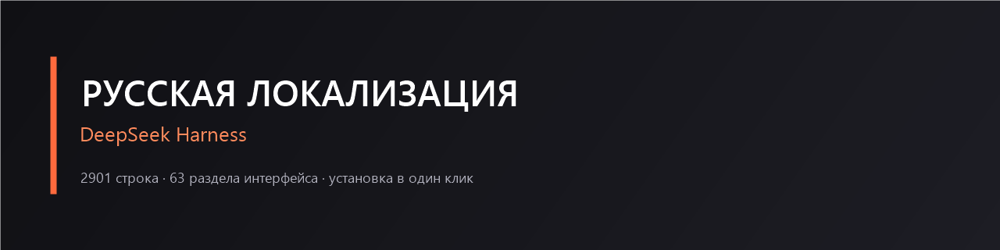

<p align="center">
  
</p>

<h1 align="center">Русская локализация DeepSeek Harness</h1>

<p align="center">
  <a href="https://github.com/cptn73m0/dsh-locale-ru/releases/latest"></a>
  <a href="https://github.com/cptn73m0/dsh-locale-ru/actions/workflows/release.yml"></a>
  
</p>

> ## ⚠️ Пакет больше не нужен
>
> **В DeepSeek Harness 0.2.2 появилась официальная локализация, включая русский язык.**
> DSH сам регистрирует язык `ru` и словари для всех разделов интерфейса
> (8 языков: `zh`, `en`, `ja`, `es`, `fr`, `de`, `ru`, `pt`), поэтому этот пакет
> больше не устанавливается и не обновляется.
>
> Старая версия пакета **0.1.x** в DSH 0.2.2+ конфликтует со встроенным переводом
> и ломает загрузку web-клиента: в журнале сбоя появляется
> `web boot: 1 entry did not activate` / `dsh-locale-ru: failed`.

## Что делать

### Пакет 0.1.x был установлен

1. Скачайте [`dsh-locale-ru-cleanup-0.2.0.exe`](https://github.com/cptn73m0/dsh-locale-ru/releases/latest)
   из последнего релиза и запустите.
2. Перезапустите DeepSeek Harness.

Средство очистки удалит языковой пакет, зависимость и запись загрузчика из профиля
DSH, а также каталог `%USERPROFILE%\.dsh\locale-packs\ru`. Русский интерфейс останется:
он уже встроен в приложение.

### Пакет не устанавливался

Ничего устанавливать не нужно. Включите русский язык в самом DSH:
**Настройки → Общие → Язык → Русский**.

### Вы используете DSH ≤ 0.2.1

В этих версиях официального русского ещё нет. Последняя версия пакета —
[релиз v0.1.2](https://github.com/cptn73m0/dsh-locale-ru/releases/tag/v0.1.2)
(установщик `.exe` и архив ручной установки). На DSH 0.2.2+ этот пакет не ставьте.

## Что произошло

- DSH 0.2.2-rc.1 содержит **официальную локализацию**: 8 языков и полные словари
  для всех 73 разделов клиентских плагинов (3618 строк на язык). Русский язык
  включается штатным переключателем языка и обновляется вместе с приложением.
- Пакет 0.1.x был рассчитан на DSH ≤ 0.2.1 и регистрировал собственные словари
  для языка `ru`. В 0.2.2 язык и словари уже зарегистрированы официально, поэтому
  регистрация пакета завершается ошибкой «locale "ru" is already registered»,
  и DSH сообщает `dsh-locale-ru: failed`.
- Технически переопределить официальные словари через публичный API нельзя,
  поэтому продолжать выпуск пакета как перевода не имеет смысла.

## Что делает средство очистки 0.2.0

`dsh-locale-ru-cleanup-0.2.0.exe` — небольшой одноразовый инструмент, который:

1. запускает штатный деинсталлятор пакета 0.1.x, если он устанавливался через `.exe`;
2. убирает зависимость `dsh-locale-ru` из `package.json` профиля `desktop`;
3. убирает вставку `locale-ru` из `cordis.patch.yml` профиля;
4. удаляет `%USERPROFILE%\.dsh\locale-packs\ru` (в том числе после ручной установки
   из архива);
5. удаляет запись «Русская локализация DeepSeek Harness» из «Приложений и возможностях»,
   если деинсталлятор не сработал.

Инструмент идемпотентен: его можно запускать повторно, ничего лишнего он не удалит.
Установки он не создаёт и в системе не остаётся.

Файлы репозитория:

| Файл | Назначение |
| --- | --- |
| `cleanup/cleanup-offline.ps1` | Скрипт очистки профиля и пакета |
| `cleanup/cleanup-info.txt` | Текст на финальной странице средства очистки |
| `installer/cleanup.iss` | Сценарий Inno Setup для сборки `.exe` |
| `.github/workflows/release.yml` | Сборка и публикация релиза в GitHub Actions |

## Сборка средства очистки

```powershell
New-Item -ItemType Directory -Force payload | Out-Null
Copy-Item cleanup\cleanup-offline.ps1 payload -Force

ISCC.exe /DMyAppVersion=0.2.0 installer\cleanup.iss
```

Готовый файл появится в `dist\dsh-locale-ru-cleanup-0.2.0.exe`. Релиз собирается
GitHub Actions при пуше тега `v*`.

## Архив: как работал пакет 0.1.x

До DSH 0.2.2 пакет добавлял язык `ru` через `ctx.locale.addLanguage` и регистрировал
словари `ctx.locale.register` для клиентских плагинов профиля `desktop`
(2910 строк в 64 пространствах имён). Он не патчил `app.asar` и подключался обычной
строкой загрузчика в `cordis.patch.yml`. Исходные файлы (`lib/client.js`,
`locale/ru.json`, `install*.ps1`, `installer/installer.iss`) сохранены в репозитории
для истории и для сборки релиза v0.1.2.

## Лицензия

[MIT](LICENSE). DeepSeek Harness — продукт DeepSeek; этот репозиторий не связан
с компанией и распространяется сообществом.
