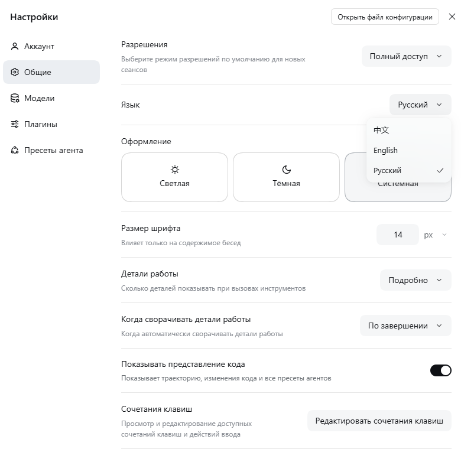
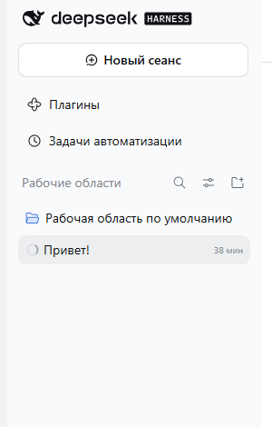

<p align="center">
  
</p>

<h1 align="center">Русская локализация DeepSeek Harness</h1>

<p align="center">
  <a href="https://github.com/cptn73m0/dsh-locale-ru/releases/latest"></a>
  <a href="https://github.com/cptn73m0/dsh-locale-ru/actions/workflows/release.yml"></a>
  
  
  
</p>

<p align="center">
  <b><a href="https://github.com/cptn73m0/dsh-locale-ru/releases/latest">Скачать установщик .exe</a></b>
  ·
  <b><a href="https://github.com/cptn73m0/dsh-locale-ru/releases/latest">Скачать архив .zip</a></b>
</p>

Неофициальный языковой пакет, который полностью переводит интерфейс
[DeepSeek Harness](https://github.com/deepseek-ai/deepseek-harness) на русский язык:
чат, боковую панель, настройки, траекторию, задачи, расписание, плагины, субагентов,
голосовой ввод и предпросмотр документов.

Пакет **не патчит `app.asar`** и не трогает файлы установки. Он подключается как обычный
клиентский плагин профиля `desktop` через штатный механизм языковых пакетов DSH
(`ctx.locale.addLanguage` + `ctx.locale.register`) и переживает обновления приложения.

## Скриншоты

<p align="center">
  
  
</p>

## Что переведено

| Область | Примеры |
| --- | --- |
| Чат и композер | подсказки, статусы хода, ошибки, пустые состояния |
| Боковая панель | сеансы, рабочие области, плагины, задачи автоматизации |
| Настройки | общие, модели, аккаунт, плагины, пресеты агента, тема |
| Траектория | панель инструментов, сводки, вызовы, шаги |
| Инструменты | задачи, расписание, цели, планы, субагенты, workflow |
| Документы | предпросмотр Word, Excel, PDF, изображений |
| Прочее | сочетания клавиш, голосовой ввод, магазин плагинов |

Всего — **2901 строка** в **63 пространствах имён** клиентских плагинов DSH.

## Установка

### Вариант 1: установщик `.exe` (рекомендуется)

1. Скачайте `dsh-locale-ru-setup-*.exe` из [последнего релиза](https://github.com/cptn73m0/dsh-locale-ru/releases/latest).
2. Запустите установщик. SmartScreen может предупредить — подпись у файла отсутствует.
3. Перезапустите DeepSeek Harness.

Установщик кладёт пакет в `%USERPROFILE%\.dsh\locale-packs\ru`, добавляет зависимость
в профиль `desktop`, прописывает строку загрузчика в `cordis.patch.yml` и создаёт
штатное средство удаления в «Приложениях и возможностях».

### Вариант 2: архив `.zip` (ручная установка)

1. Скачайте `dsh-locale-ru-manual.zip` из [релиза](https://github.com/cptn73m0/dsh-locale-ru/releases/latest) и распакуйте.
2. Откройте PowerShell в папке и выполните:

```powershell
powershell -NoProfile -ExecutionPolicy Bypass -File .\install.ps1
```

3. Перезапустите DeepSeek Harness.

Удаление:

```powershell
powershell -NoProfile -ExecutionPolicy Bypass -File .\uninstall.ps1
```

### Вариант 3: из исходников

```powershell
git clone https://github.com/cptn73m0/dsh-locale-ru.git
cd dsh-locale-ru
powershell -NoProfile -ExecutionPolicy Bypass -File .\install.ps1
```

## Переключение языка

После установки интерфейс переключается на русский автоматически. Вручную:
**Настройки → Общие → Язык → Русский**. Доступны русский, английский и китайский.

## Что остаётся на английском

- Ответы модели и содержимое ваших файлов.
- Названия инструментов и технические идентификаторы (`Pwsh`, `Read`, `Bash`, `DeepSeek`, `API`, `JSON`).
- Описания сторонних плагинов из их `package.json` — они поставляются только на английском и китайском.
- Служебные сообщения хоста и диагностика вне клиентских словарей.
- Новые строки, добавленные в DSH после выхода этой версии перевода.

## Как это работает

DSH поддерживает внешние языковые пакеты. Клиентский плагин регистрирует язык и словари
для пространств имён интерфейса; активный язык выбирается в настройках и сохраняется в профиле.

```js
export const inject = ['locale']

export function apply(ctx) {
  ctx.effect(() => ctx.locale.addLanguage({ id: 'ru', label: 'Русский', fallback: 'en' }))
  ctx.effect(() => ctx.locale.register('common', 'ru', { ok: 'ОК', cancel: 'Отмена' }))
}
```

Профиль загружает пакет обычной строкой загрузчика:

```yaml
- insert:
    - id: locale-ru
      name: dsh-locale-ru
```

Файлы репозитория:

| Файл | Назначение |
| --- | --- |
| `package.json` | Манифест плагина (`dsh.client`, платформа `web`) |
| `lib/client.js` | Сгенерированный клиентский бандл со словарями |
| `lib/index.js` | Пустая хост-часть |
| `locale/ru.json` | Словарь в читаемом виде |
| `install.ps1` / `uninstall.ps1` | Ручная установка и удаление |
| `install-offline.ps1` / `uninstall-offline.ps1` | Установка без сети и Node.js (используется `.exe`) |
| `installer/installer.iss` | Сценарий Inno Setup для сборки `.exe` |
| `.github/workflows/release.yml` | Сборка `.exe` и `.zip`, публикация релиза |

## Сборка

Пересобрать клиентский бандл из словаря:

```powershell
node tools/build-client.mjs
```

Релиз собирается GitHub Actions при пуше тега:

```powershell
git tag v0.1.0
git push origin v0.1.0
```

Workflow соберёт `dsh-locale-ru-setup-<version>.exe` через Inno Setup, упакует ручной архив
и опубликует оба файла в GitHub Releases.

## Ограничения

- Перевод неофициальный и может отставать от новых версий DSH.
- Установщик не подписан: SmartScreen может показать предупреждение.
- Пакет рассчитан на Windows и профиль `desktop`.
- После обновления DSH новые строки останутся на английском до обновления пакета.

## Лицензия

[MIT](LICENSE). DeepSeek Harness — продукт DeepSeek; этот репозиторий не связан с компанией
и распространяется сообществом.
